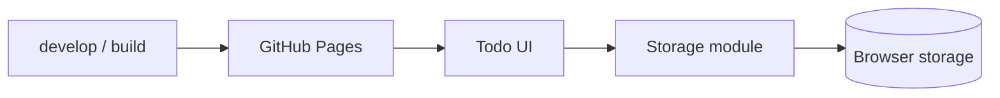

# Idea: todoit v1: a usable todo app live on GitHub Pages

## Summary
Chart the way to the first working version of todoit: a static web app served from GitHub Pages that keeps todos in the browser's own storage, so anyone can open it and use it while the code sits in the repo beside it.

## Destination

todoit v1 works live: a fun, usable todo app served from this repo's GitHub Pages site, keeping each visitor's todos in their own browser's storage, built from `develop` through the lane workflow so the code and its history sit beside the running app.

## Architecture

The app is static: the UI talks only to a storage module, which owns the browser storage engine, and GitHub Pages serves the built files.

## Outcomes

- [ ] Todos can be added, listed, completed, edited and deleted (todoit-v1-app). Not built: no app code exists.
- [ ] The list filters by all, active and done (todoit-v1-app). Not built: no app code exists.
- [ ] Todos survive a reload and a browser restart, kept in the visitor's browser storage (todoit-v1-app). Not built: no storage code exists.
- [ ] A popped todo can be restored and a delete can be undone (todoit-v1-app). Not built: no app code exists.
- [ ] Active and done counts and an all-time popped tally are always visible (todoit-v1-app). Not built: no app code exists.
- [ ] Popping has sound and visual effects, with a remembered mute toggle and reduced-motion support (todoit-v1-app). Not built: no app code exists.
- [ ] The app is live at the repo's public GitHub Pages URL (todoit-v1-publish). Not built: no Pages site and no deploy workflow.

## Decisions

- v1 does add, list, complete, edit, delete and filter by all, active or done, not the four basics alone and not due dates or ordering, because it is the smallest scope that splits into more than one build.
- The app is a static site on GitHub Pages with todos in the browser's storage, not a front end plus a server API, because anyone coming to the example can open it and see it working with nothing to install.
- This epic ends when v1 works live, not when its design is ready, because the walkthrough is meant to show the whole loop from discovery to a landed lane.
- Todos are stored in IndexedDB behind one storage module that versions its schema, not SQLite compiled to WebAssembly and not `localStorage`, because it is the browser's own engine for structured data and needs no extra download or special hosting headers.
- The app is plain HTML and JavaScript modules with no build step, not React or TypeScript with Vite, because Pages can serve the repo's files as they are.
- The app's logic has unit tests, kept apart from the DOM and storage so the tests run without a browser.
- GitHub Pages publishes from `main`, not `develop`, so publishing is a deliberate merge of `develop` into `main`.
- Todos show as bubbles the visitor pops to complete, each pop dropping a marble into a jar that keeps every pop ever while a ring around the jar fills for the current list, as in `scratch/E-todoit-v1/prototypes/iteration-2/jar-ring.html` (bubble-interaction-prototype), not the slingshot blast, the packed cluster, the fill-line jar or the shelf of day jars, because the user picked the jar with the cluster's ring turned into it.
- The look is washday, soap bubbles with pastel rims on a pale sky, as in `scratch/E-todoit-v1/mockups/washday.html` (visual-aesthetic-mockups), not underwater, space or abstract, because the user picked it and soap bubbles are what a visitor pops.
- A popped todo can be restored from the done view and a delete offers an undo toast for a few seconds, not permanent pops and deletes and not an "are you sure?" prompt, because the pop keeps its finality while a mis-tap costs nothing.
- Progress shows as live active and done counts plus a lasting all-time popped tally kept in IndexedDB, not counts alone and not a level or XP bar, because the tally is the cheapest lasting reward and an XP bar would pass v1's scope.
- Sound starts on after the first tap with a mute toggle remembered in the browser, and motion follows the system's reduced-motion setting, not sound off with no settings and not a settings panel, because people differ and one toggle is the smallest opt-out.
- Lanes are checked by Playwright browser tests of the main flows (add, pop, filter, reload keeps todos) plus `ux-verifier` for the look, beside the logic's unit tests, not screenshots alone and not a choice left until after the prototypes, because only a browser test proves todos survive a reload.
- Fun means the transcript's five principles, impact, reward, challenge, fantasy and people differ, applied to every design choice in this epic (fun-principles), because the user set `scratch/repo-setup/fun.md` as the definition of fun.

## Not Yet Specified

## Out of Scope

- A server, an API or accounts: v1 keeps every visitor's todos in their own browser.
- Grouping todos by date with a shelf of jars for the coming days, filed as the idea `day-jars-group-todos-by-date-with-a`: the user wants it later and kept out of this epic to push toward a release.

## Context

### Intent
_Not captured._

### Observed State (captured 2026-10-18T17:19:02.834Z)
- **Working directory:** D:\dev\github\todoit
- **Repo / branch:** todoit / develop
- **HEAD:** 92ccd1e — docs: add todoit-expert wiki
- **Working tree:** clean
- **Recent commits (last 3):**
  - 92ccd1e docs: add todoit-expert wiki
  - cb7c2c9 docs: switch lanes to worktree mode
  - 708441b docs: add CLAUDE.md with lane settings

### Prior Investigation
_Not captured._

## Impact
_Not captured._

## Related
_Not captured._

## Notes
_Not captured._
